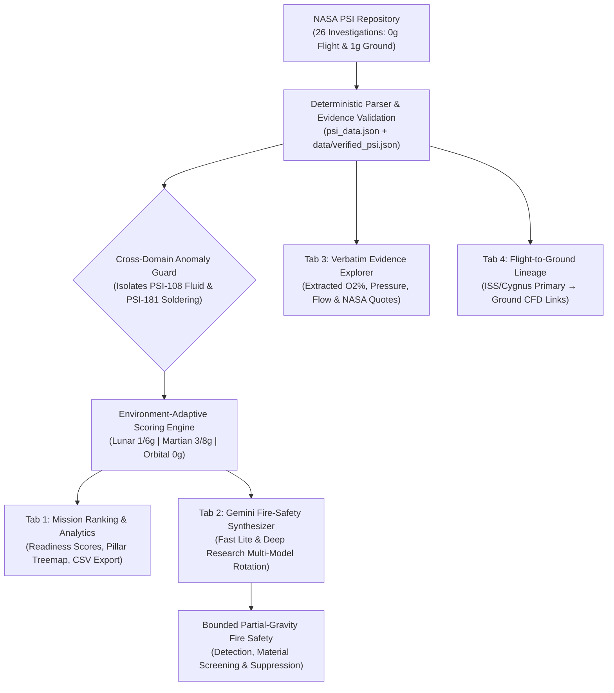
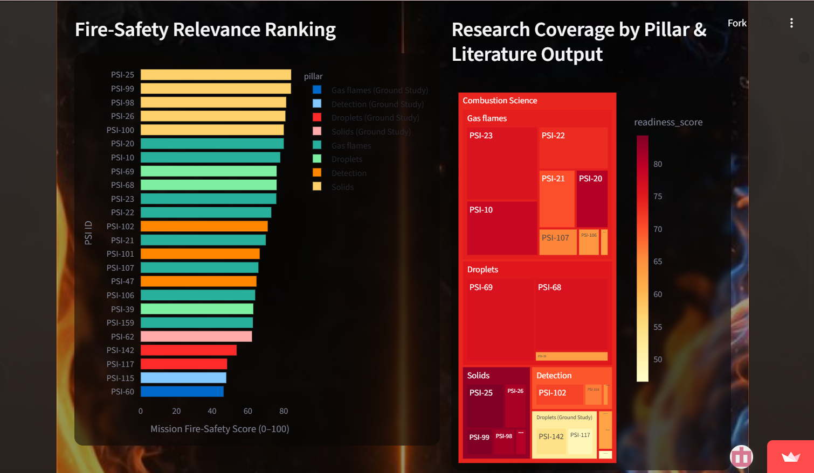
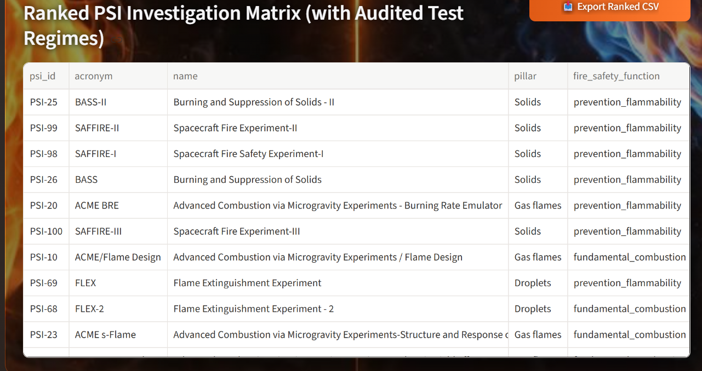
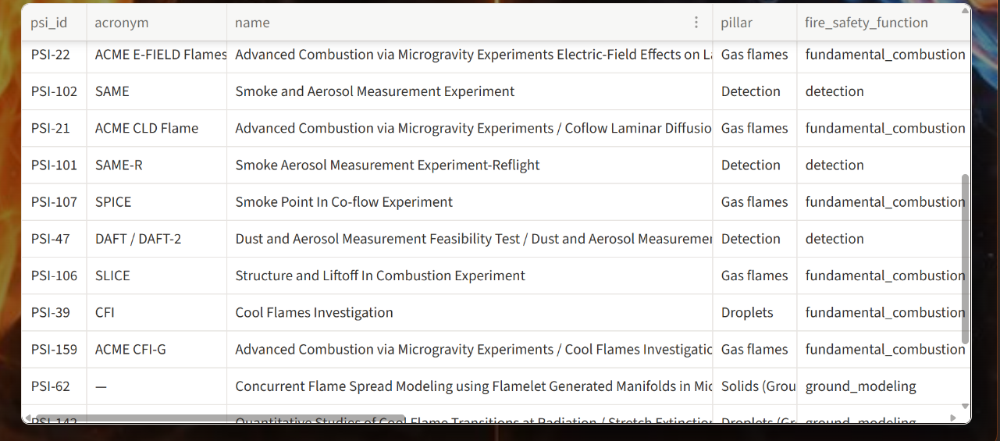
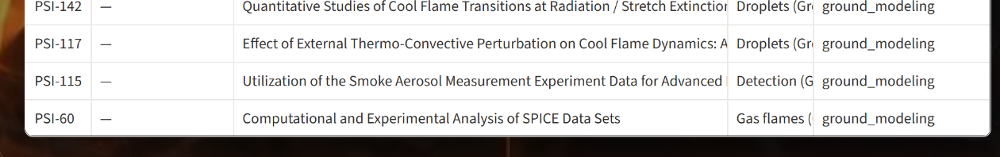

# TAARA — Flame in Freefall

**NASA Space Apps Challenge 2026 · Flame in Freefall: Microgravity Combustion Intelligence Dashboard**

An interactive, evidence-grounded intelligence dashboard that ranks, compares, and synthesizes **NASA Physical Sciences Informatics (PSI)** combustion investigations—helping spacecraft engineers and researchers bound fire safety risks for **Orbital ($0g$)**, **Lunar ($1/6g$)**, and **Martian ($3/8g$)** habitats.

> **Live App:** [spaceapps-taara-flame-in-freefall.streamlit.app](https://spaceapps-taara-flame-in-freefall.streamlit.app/) · **Demo:** [Watch the demo](https://drive.google.com/file/d/10s2lhf4rXUMcbocrBxwwq22Y9h4eAK5F/view?usp=drive_link) · **Team:** Team TAARA (GIKI) · **License:** [MIT](LICENSE)

---

## Why This Matters
Fire is one of the most critical hazards in crewed spaceflight—from Apollo 1 and Apollo 13 to the 1997 Mir oxygen-generator fire. On Earth ($1g$), buoyancy pulls hot combustion gases upward into a familiar teardrop flame. In microgravity ($0g$), buoyancy disappears—producing spherical flame balls, radiative extinction limits, and diffusive-thermal cellular **finger fronts** ($Le < 1$) that alter material flammability and smoke transport.

Because NASA's PSI archive contains $0g$ flight and $1g$ ground datasets—and no permanent partial-gravity fire laboratories exist yet—mission designers must use documented $0g$ and $1g$ experiments to **bound** fire safety for upcoming **Lunar ($1/6g$)** (where reduced-pressure, oxygen-enriched cabins such as $26.5\%\ \text{O}_2$ at $10.2\ \text{psia}$ or $34\%\ \text{O}_2$ at $8.2\ \text{psia}$ are studied) and **Martian ($3/8g$)** exploration habitats.

---

## System Architecture



---

## What the Dashboard Does

| Capability | Dashboard Location |
|---|---|
| **Environment-Adaptive Relevance Ranking:** Dynamically scores investigations ($0\text{--}100$) for **Lunar ($1/6g$)**, **Martian ($3/8g$)**, or **Orbital ($0g$)** mission profiles, paired with pillar coverage treemaps and one-click CSV export (`taara_psi_ranked.csv`). | **Tab 1:** Mission Ranking & Analytics |
| **Grounded AI Partial-Gravity Synthesizer:** Synthesizes selected $0g$ and $1g$ studies via Gemini (with Fast Lite & Deep Research tiers) into actionable material, detection, and suppression bounds—citing exact `[PSI-XX]` IDs and flagging `null` parameters. | **Tab 2:** AI Fire-Safety Synthesizer |
| **Evidence & Verbatim Quote Explorer:** Inspects every investigation's fuel/material, $\text{O}_2\%$, pressure, flow speed, and hardware alongside **verbatim NASA PSI source sentences** and peer-reviewed publications. | **Tab 3:** Investigation Deep-Dive & Evidence |
| **Flight-to-Ground Lineage & Anomaly Guard:** Maps ISS/Cygnus primary flight studies to follow-on ground CFD/modeling investigations while isolating `out_of_scope` non-combustion controls (`PSI-108` Fluid Physics, `PSI-181` Soldering). | **Sidebar & Tab 4:** Flight-to-Ground Lineage |

---

## Dashboard Preview
Screenshots of the live dashboard:


*Fire-Safety Relevance Ranking (0–100 mission score) and the Research Coverage treemap by pillar, coloured by readiness score.*


*Ranked PSI Investigation Matrix with the one-click CSV export (top of the table).*


*Same matrix scrolled: detection studies (SAME, SAME-R, DAFT) and gas-flame studies (ACME, SPICE, SLICE).*


*Bottom of the matrix: ground-modeling investigations that build on flight data.*

---

## Data & Scientific Integrity Pipeline
1. **26 PSI Investigations (`psi_data.json`):** Extracted deterministically via `extract.py` from NASA PSI ISA-Tab files (`data/raw/`), spanning primary flight experiments and follow-on ground validation studies (`PSI-108` and `PSI-181` are flagged as non-combustion controls and excluded by default).
2. **Evidence Layer (`data/verified_psi.json` & `data/validate_psi.py`):** Structured test conditions (`fuel_type`, `material_tested`, `o2_concentration`, `pressure`, `flow_speed`, `diluents_suppressants`) are extracted offline with Gemini (`extract_conditions.py`) from each record's text. Every non-null value is accompanied by a verbatim NASA quote, and unstated fields remain `null`. `validate_psi.py` then checks the schema and evidence integrity of all 26 records.
<!-- TODO (team): if team members manually reviewed these records against the NASA sources, say so here, naming who reviewed which records. Do not claim "human-verified" otherwise. -->
3. **Partial-Gravity Bounding Caveat:** Because PSI holds $0g$ flight and $1g$ ground datasets rather than direct $1/6g$ or $3/8g$ flight tests, all Moon and Mars outputs are explicitly framed as **engineering bounds and extrapolations**.

See [`docs/si_usage_log.md`](docs/si_usage_log.md) and [`docs/decision_log.md`](docs/decision_log.md) for full provenance and governance logs.

---

## Use of SI (Scientific Intelligence / AI)
AI was used both inside the product and while building it. Details and safeguards are in [`docs/si_usage_log.md`](docs/si_usage_log.md).

| Where | Tool | What it does | Safeguards |
|---|---|---|---|
| **App, Tab 2** (AI Fire-Safety Synthesizer) | Gemini via the `google-genai` SDK | Synthesizes the PSI records the user selects into a fire-safety assessment with `[PSI-XX]` citations | Receives only the selected PSI records; the prompt forbids numbers that are not in those records; falls back to "not in PSI metadata"; output is labelled as AI-generated and never presented as a measured result |
| **Offline data extraction** (`extract_conditions.py`) | Gemini | Extracts structured test conditions from each record's objective and approach text into `data/verified_psi.json` | Verbatim evidence quote required for every non-null value; `needs_review` flags; checked by `data/validate_psi.py` |
| **Development** | Claude (Anthropic) | Code review of the repository, a parser fix, the extraction script, and drafts of the README, documentation and submission text | Output reviewed and edited by the team before use |

Code and text generated or revised with AI assistance are acknowledged here and in the usage log. Moon and Mars statements in the app are extrapolations from $0g$ and $1g$ data and are labelled as such.
<!-- TODO (team): add any other coding or planning assistants used (see the "_Gemini/other_" row of docs/si_usage_log.md), and state whether any image in assets/ was made with an AI image tool (such images need a visible label). -->

---

## Run Locally

**macOS / Linux (bash)**
```bash
git clone https://github.com/taara-flame-in-freefall/taara-flame-in-freefall.git
cd taara-flame-in-freefall

python -m venv venv
source venv/bin/activate

pip install -r requirements.txt
cp .env.example .env   # Add your GEMINI_API_KEY inside .env
streamlit run app.py
```

**Windows (PowerShell)**
```powershell
git clone https://github.com/taara-flame-in-freefall/taara-flame-in-freefall.git
cd taara-flame-in-freefall

python -m venv venv
venv\Scripts\Activate.ps1

python -m pip install -r requirements.txt
Copy-Item .env.example .env   # Add your GEMINI_API_KEY inside .env
python -m streamlit run app.py
```
> If PowerShell blocks the activation script, run `Set-ExecutionPolicy -Scope CurrentUser -ExecutionPolicy RemoteSigned` once. If `streamlit` is not recognised, use `python -m streamlit run app.py`.

### Rebuild & Validate Dataset

**bash**
```bash
python extract.py && cp build/output/investigations.json psi_data.json
python extract_conditions.py --dry-run
python extract_conditions.py
python data/validate_psi.py
```

**PowerShell**
```powershell
python extract.py
Copy-Item build\output\investigations.json psi_data.json -Force
python extract_conditions.py --dry-run
python extract_conditions.py
python data\validate_psi.py
```
> `extract_conditions.py` calls Gemini, so it needs `GEMINI_API_KEY`.
>
> **Security Note:** Never commit `.env` (already excluded in `.gitignore`). For cloud deployment, configure `GEMINI_API_KEY` via Streamlit Community Cloud `st.secrets`.

---

## Repository Layout

```text
taara-flame-in-freefall/
├── app.py                     # Main Streamlit intelligence dashboard & Gemini synthesizer
├── extract.py                 # Deterministic ISA-Tab -> psi_data.json parser
├── extract_conditions.py      # Offline Gemini-based condition extractor -> data/verified_psi.json
├── psi_data.json              # Normalized 26-investigation NASA PSI dataset
├── requirements.txt           # Python dependencies
├── .env.example               # Template for GEMINI_API_KEY
├── assets/                    # Custom cosmic obsidian UI & combustion graphics
├── data/
│   ├── raw/                   # Source ISA-Tab investigation files from NASA PSI
│   ├── verified_psi.json      # 26 records of structured conditions with verbatim evidence quotes
│   └── validate_psi.py        # Schema & evidence integrity validation script
└── docs/
    ├── decision_log.md
    ├── si_usage_log.md
    ├── combustion_physics_framework.md
    ├── ayesha_s_project_contributions.md
    ├── nimra_contribution.md
    ├── tahoora_project_contributions.md
    └── yasin_contribution.md
```

---

## Team TAARA (GIKI)

| Member | GitHub | Role & Contributions |
|---|---|---|
| **Muhammad Zain Nasir** | [@the-fool-zn](https://github.com/the-fool-zn) | Team Lead, Full-Stack Architecture, Scoring Engine & Gemini Integration |
| **Muhammad Shomail** | [@Shumyl0-0](https://github.com/Shumyl0-0) | Data Pipeline Lead & Deterministic PSI Extraction (`extract.py`) |
| **Muhammad Yasin** | [@yasin9274](https://github.com/yasin9274) | Data Verification, Schema Validation (`validate_psi.py`) & Audit Lead |
| **Nimra Pervez** | [@nimrapervez123-hub](https://github.com/nimrapervez123-hub) | Dataset Curation & Evidence Verification |
| **Ayesha Farooq Ahmed** | [@ashfar332](https://github.com/ashfar332) | Visual Design, Custom Assets (`assets/`), Frosted Glass UI & Asset Pipeline |
| **Tahoora Jamil Qureshi** | [@tahoorajamil123-arch](https://github.com/tahoorajamil123-arch) | Quality Assurance (QA), System Architecture, Scientific Narrative & Pitch Lead |

---

## Sources & Attribution
- **Data:** NASA Physical Sciences Informatics (PSI) Data Repository ([https://psi.nasa.gov](https://psi.nasa.gov)). Each investigation is cited by its official NASA PSI ID and DOI.
- **Software:** Streamlit, Plotly, pandas, python-dotenv, and the Google Gen AI SDK (Gemini).
- **Background:** NASA Combustion Science Program, Apollo 1 / Apollo 13 / Mir fire safety case studies, *Researcher's Guide to Combustion Science*, and NASA Spinoff publications.
- *Disclaimer: NASA does not endorse this project.*

## License
This project is licensed under the **MIT License** — see the [LICENSE](LICENSE) file for details.